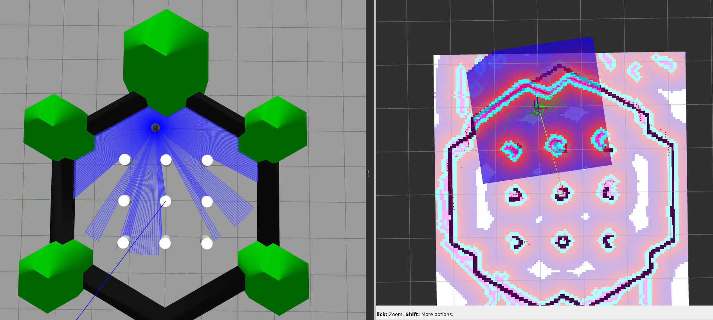
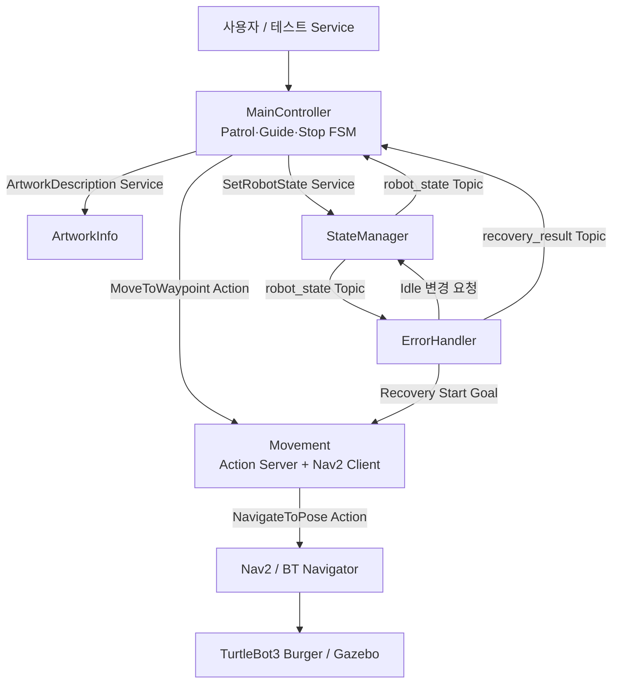

# Museum Docent Robot v1.1

**ROS 2 Humble · C++17 · TurtleBot3 Burger · Gazebo Classic · Nav2**

- **프로젝트:** ROS 2 기반 박물관 도슨트 로봇 개인 프로젝트
- **목표:** 자율 순찰·사용자 안내·작품 설명·오류 복구 흐름 통합
- **구현 범위:** FSM, Topic/Service/Action, Nav2 주행, Goal Cancel, Error/Recovery
- **시뮬레이션:** 공식 TurtleBot3 World를 활용한 가상 전시 공간

## Simulation Environment



- **로봇:** TurtleBot3 Burger
- **환경:** `turtlebot3_world` + Gazebo Classic + RViz2
- **지도:** `turtlebot3_world.yaml` 기반 AMCL 위치 추정 및 Nav2 주행
- **작품 위치:** 월드 내 9개 기둥 중 왼쪽 기준 1·2·3번째 기둥을 가상 `Artwork1~3`으로 지정
- **범위 구분:** 박물관 전용 World 미구현

## Version Comparison

| 항목 | v1.0 | v1.1 |
|---|---|---|
| **개발 중심** | ROS 2 노드 및 작업 흐름 구현 | TurtleBot3 Burger 실제 시뮬레이션 주행 연동 |
| **이동** | `MoveToWaypoint` Action 기반 동작 구조 | Nav2 `NavigateToPose` 연계, Goal 결과·취소 처리 |
| **Waypoint** | 작품 순서 및 목표 이름 관리 | YAML 기반 `map` 좌표 적용 |
| **상태 관리** | Patrol·Guide FSM 및 로봇 상태 관리 | `WorkPhase` 기반 작업 단계·비동기 Goal 관리 개선 |
| **Error / Recovery** | 오류 및 Start 복귀 기본 흐름 | Nav2 `ABORTED`, 복구 실패·재시도 통합 검증 |

## Main Features

| Feature | Flow |
|---|---|
| **Patrol** | `Start → Artwork1 → Artwork2 → Artwork3 → Goal → Start` |
| **User Request** | 이동 취소 → `Waiting` 전환 |
| **Guide Yes** | 선택 작품 이동 → 설명 Service → Patrol 복귀 |
| **Guide No** | 중단된 순찰 목적지부터 재개 |
| **Stop** | 현재 작업 종료 → Start 복귀 → `Idle` |
| **Error** | Nav2 실패 → `Error` 전환 → 일반 요청 차단 |
| **Recovery** | Start 복귀 재시도 → 성공 시 `Idle` / 실패 시 `Error` 유지 |

> **Stop:** 점검용 작업 종료 및 복귀 기능 · 긴급 정지(E-Stop) 기능과 구분

## System Architecture



| Node | Role |
|---|---|
| `main_controller` | Patrol·Guide·Stop 작업 흐름 및 FSM 관리 |
| `movement` | Waypoint 좌표 변환, Nav2 Action Goal·Cancel·Result 중계 |
| `state_manager` | `Idle / Moving / Waiting / Arrived / Error` 관리·발행 |
| `artwork_info` | 작품 설명 Service 응답 |
| `error_handler` | Error 감지, 복구 이동·완료 결과 관리 |

## ROS 2 Interfaces

- **Topics:** `/robot_state`, `/recovery_result`
- **Services:** `/start_signal`, `/stop_patrol`, `/user_request`, `/guide_response`, `/artwork_description`, `/set_robot_state`, `/test_error`, `/recovery_request`
- **Actions:** `/move_to_waypoint`, Nav2 `/navigate_to_pose`
- **Waypoint 설정:** `src/museum_docent_robot/config/waypoints.yaml`

## Build & Run

- **개발 환경:** Ubuntu 22.04 / WSL2 · ROS 2 Humble · C++17
- **필수 구성:** TurtleBot3 Gazebo/Navigation2 패키지, 저장된 지도 YAML·PGM
- **초기 위치:** RViz `2D Pose Estimate` 설정 후 Nav2 활성 상태 확인
- **실행 방식:** Gazebo·Nav2·프로젝트 노드 5개 각각 별도 터미널

<details>
<summary><b>빌드 및 실행 명령어</b></summary>

**1. 빌드**

```bash
source /opt/ros/humble/setup.bash
source ~/turtlebot3_ws/install/setup.bash
cd ~/museum_ws
colcon build --packages-select museum_docent_robot --symlink-install
```

**2. Gazebo — 터미널 A**

```bash
source /opt/ros/humble/setup.bash
source ~/turtlebot3_ws/install/setup.bash
export TURTLEBOT3_MODEL=burger
GAZEBO_MODEL_DATABASE_URI="" ros2 launch turtlebot3_gazebo turtlebot3_world.launch.py
```

**3. Nav2 — 터미널 B**

```bash
source /opt/ros/humble/setup.bash
source ~/turtlebot3_ws/install/setup.bash
export TURTLEBOT3_MODEL=burger
ros2 launch turtlebot3_navigation2 navigation2.launch.py use_sim_time:=True map:=$HOME/turtlebot3_ws/maps/turtlebot3_world.yaml
```

**4. 프로젝트 노드 — 터미널 C~G**

각 터미널 공통 환경 설정:

```bash
source /opt/ros/humble/setup.bash
source ~/turtlebot3_ws/install/setup.bash
source ~/museum_ws/install/setup.bash
```

각 터미널에서 아래 명령 중 하나씩 실행:

```bash
ros2 run museum_docent_robot state_manager --ros-args -p use_sim_time:=true
ros2 run museum_docent_robot movement --ros-args -p use_sim_time:=true
ros2 run museum_docent_robot main_controller --ros-args -p use_sim_time:=true
ros2 run museum_docent_robot error_handler --ros-args -p use_sim_time:=true
ros2 run museum_docent_robot artwork_info --ros-args -p use_sim_time:=true
```

</details>

## Validation

- **정상 동작:** Patrol 전체 순환, Guide Yes/No, 작품 설명, Stop·재시작 검증
- **상태 제어:** 이동 취소 후 Waiting, 중복 요청 및 Error 중 일반 요청 차단 검증
- **Navigation 실패:** 실제 Nav2 `ABORTED` → MainController Error 전환 확인
- **Recovery:** 실패 시 Error 유지, 재시도 성공 후 Start·Idle 복귀 확인
- **검증 방식:** TurtleBot3 Gazebo 기반 수동 통합 테스트

## Future Work

- 박물관 전용 World 구성
- 통합 Launch 및 자동화 테스트
- 실물 로봇 적용 및 장시간 안정성 검증
