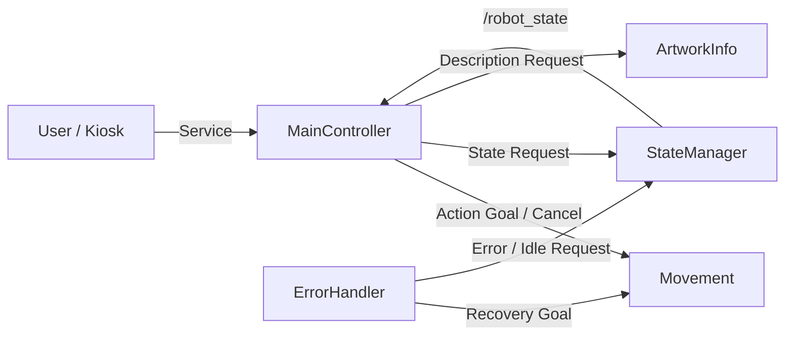

# Museum Docent Robot v1.0

ROS2 C++ 기반 박물관 도슨트 로봇 개인 프로젝트입니다.

TurtleBot3 1대를 기준으로 순찰(Patrol), 사용자 안내(Guide), 작품 설명, 상태 관리, Error / Recovery 흐름을 `Topic / Service / Action`으로 구현했습니다.

## System Architecture



## Project Structure

```text
museum_docent_robot/
├── action/
│   └── MoveToWaypoint.action
├── srv/
│   ├── SetRobotState.srv
│   ├── GuideResponse.srv
│   └── ArtworkDescription.srv
├── src/
│   ├── main_controller.cpp
│   ├── state_manager.cpp
│   ├── movement.cpp
│   ├── artwork_info.cpp
│   └── error_handler.cpp
├── CMakeLists.txt
├── package.xml
└── README.md
```

## Main Nodes

| Node | Role |
|---|---|
| `MainController` | Patrol / Guide 흐름 및 FSM 관리 |
| `StateManager` | RobotState 관리 및 상태 발행 |
| `Movement` | Waypoint 이동 Action Server |
| `ArtworkInfo` | 작품 설명 Service |
| `ErrorHandler` | Error / Recovery 처리 |

## Main Flow

### Patrol

`Start → Artwork1 → Artwork2 → Artwork3 → Goal → Start`

### Guide

`Patrol → User Request → Waiting → Guide 선택 → 작품 이동 → 작품 설명 → Patrol 복귀`

### Error / Recovery

`Patrol → Error → 현재 이동 중단 → Recovery → Start 복귀 → Idle`

Recovery 완료 후 `/start_signal`을 다시 보내면 Patrol을 재시작합니다.

## ROS2 Interfaces

| Type | Interface |
|---|---|
| Topic | `/robot_state` |
| Service | `/start_signal` |
| Service | `/user_request` |
| Service | `/guide_response` |
| Service | `/artwork_description` |
| Service | `/set_robot_state` |
| Service | `/test_error` |
| Service | `/recovery_request` |
| Action | `/move_to_waypoint` |

## Implemented

- [x] Patrol 순환
- [x] 사용자 요청 및 Waiting 전환
- [x] Guide 수락 / 거절
- [x] 작품 설명 Service
- [x] Action Feedback / Result / Cancel
- [x] Error 처리
- [x] Recovery 후 Start 복귀
- [x] Recovery 후 Patrol 재시작
- [x] 전체 Node 통합 테스트

## Key Issues Solved

- 비동기 Service 응답 전 Patrol이 재개되는 문제
- Error 상태가 MainController에 전달되지 않는 문제
- 종료된 GoalHandle 취소 시 `UnknownGoalHandleError`
- Error 반복 처리로 Recovery Goal까지 취소되는 문제

## Run

각 Node를 별도 터미널에서 실행합니다.

```bash
ros2 run museum_docent_robot state_manager
```

```bash
ros2 run museum_docent_robot movement
```

```bash
ros2 run museum_docent_robot artwork_info
```

```bash
ros2 run museum_docent_robot main_controller
```

```bash
ros2 run museum_docent_robot error_handler
```

상태 확인:

```bash
ros2 topic echo /robot_state
```

## Integration Test

전체 기능 테스트는 아래 순서로 진행합니다.

### 1. Patrol 시작

```bash
ros2 service call /start_signal std_srvs/srv/SetBool "{data: true}"
```

기대 흐름:

`Start → Artwork1 → Artwork2 → Artwork3 → Goal → Start`

### 2. 사용자 요청

```bash
ros2 service call /user_request std_srvs/srv/SetBool "{data: true}"
```

기대 흐름:

`현재 이동 Cancel → Waiting`

### 3. 안내 거절

```bash
ros2 service call /guide_response museum_docent_robot/srv/GuideResponse "{guide: false, artwork_id: ''}"
```

기대 흐름:

`Waiting → 기존 Patrol 재개`

### 4. 안내 수락

먼저 다시 사용자 요청:

```bash
ros2 service call /user_request std_srvs/srv/SetBool "{data: true}"
```

Artwork2 안내 요청:

```bash
ros2 service call /guide_response museum_docent_robot/srv/GuideResponse "{guide: true, artwork_id: 'Artwork2'}"
```

기대 흐름:

`Waiting → Guide → Artwork2 이동 → 작품 설명 → Patrol 복귀`

### 5. Error 테스트

```bash
ros2 service call /test_error std_srvs/srv/SetBool "{data: true}"
```

기대 흐름:

`Patrol 정지 → RobotState = Error`

### 6. Recovery

```bash
ros2 service call /recovery_request std_srvs/srv/SetBool "{data: true}"
```

기대 흐름:

`Start 복귀 → Recovery success → RobotState = Idle`

### 7. Recovery 후 Patrol 재시작

```bash
ros2 service call /start_signal std_srvs/srv/SetBool "{data: true}"
```

기대 흐름:

`Idle → Patrol 재시작`

전체 성공 기준:

`Patrol → Waiting → Guide Reject / Accept → Artwork Description → Error → Recovery → Idle → Patrol Restart`

## Future Work

- TurtleBot3 / Nav2 연동
- Gazebo / RViz 시뮬레이션
- 실제 Waypoint 좌표 적용
- YAML + ROS2 Parameter 기반 좌표 관리
- 실제 Navigation 실패와 Recovery 연결
