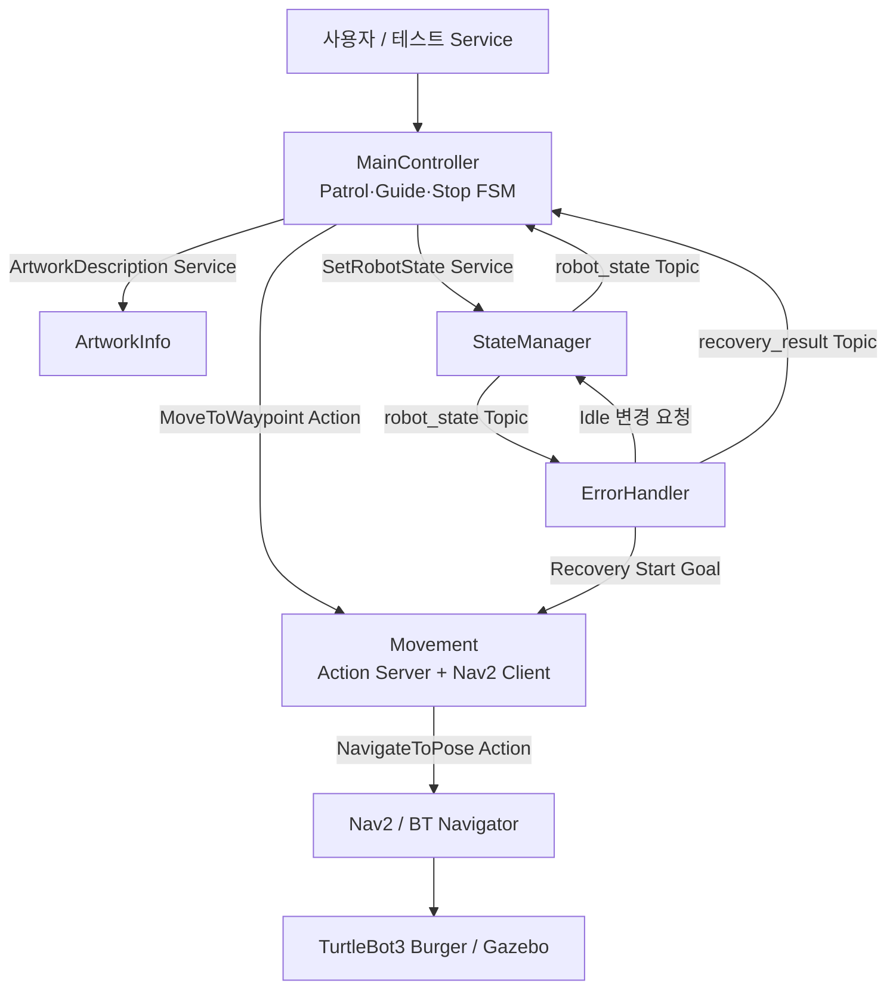

# Museum Docent Robot v1.1

**ROS 2 Humble · C++ · TurtleBot3 Burger · Gazebo Classic · Nav2**

TurtleBot3 Burger 한 대를 이용해 **순찰(Patrol), 사용자 안내(Guide), 작품 설명, 점검 복귀(Stop), 오류 처리 및 Recovery**를 구현한 ROS 2 C++ 개인 프로젝트입니다. v1.0의 Topic/Service/Action 및 FSM 구조를 유지하면서 v1.1에서는 실제 Nav2 주행, 이동 취소와 결과 처리, 비동기 상태 관리 및 복구 흐름을 통합했습니다.

> **시뮬레이션 범위:** 별도의 박물관 Gazebo World를 제작한 버전이 아닙니다. 공식 `turtlebot3_world`의 **9개 기둥 중 왼쪽에 위치한 첫째·둘째·셋째 기둥**을 각각 가상의 Artwork1·Artwork2·Artwork3 전시 위치로 지정해 안내 시나리오를 검증했습니다. Unity 및 자체 Museum World 제작은 향후 확장 범위입니다.

## 1. 기능 및 동작 흐름

| 기능 | 동작 |
|---|---|
| Patrol | `Start → Artwork1 → Artwork2 → Artwork3 → Goal → Start` 순환 |
| User Request | 순찰 이동 중 Goal Cancel 완료 후 `Waiting` 전환 |
| Guide Yes | 선택한 작품 위치로 이동 → 작품 설명 Service → 다음 순찰 지점부터 재개 |
| Guide No | 중단했던 순찰 목적지부터 재개 |
| 점검 Stop | Patrol/Waiting/Guide 중 현재 작업을 종료 → Start 복귀 → Idle |
| Navigation Error | Nav2 최종 실패(`ABORTED`) → Movement 결과 전달 → MainController Error |
| Recovery | ErrorHandler에서 Start 이동 재시도 → 성공 시 StateManager Idle 반영 → `recovery_result` 성공 통지 |

`/stop_patrol`은 **점검을 위한 작업 종료 및 Start 복귀** 기능으로, 즉시 모터를 차단하는 **긴급 정지(E-Stop)** 기능이 아닙니다.

## 2. 시스템 구성



| 노드 | 책임 |
|---|---|
| `main_controller` | 순찰·안내·점검 종료의 작업 단계(`WorkPhase`), 목표 선택, Action 결과에 따른 후속 동작 |
| `movement` | Waypoint 이름을 YAML의 `map` 기준 Pose로 변환, Nav2 `NavigateToPose` 요청·취소·결과 전달, Goal 중복 수락 방지 |
| `state_manager` | `Idle / Moving / Waiting / Arrived / Error` 상태 저장과 `/robot_state` 발행 |
| `error_handler` | Error 발생 테스트, Recovery Goal의 수락·진행·결과 처리 및 완료 이벤트 |
| `artwork_info` | 작품 설명 요청에 대한 Service 응답 |

### ROS 2 인터페이스

| 종류 | 이름 | 타입 |
|---|---|---|
| Topic | `/robot_state` | `std_msgs/msg/String` |
| Topic | `/recovery_result` | `std_msgs/msg/String` (`SUCCEEDED`) |
| Service | `/start_signal` | `std_srvs/srv/SetBool` |
| Service | `/stop_patrol` | `std_srvs/srv/SetBool` |
| Service | `/user_request` | `std_srvs/srv/SetBool` |
| Service | `/guide_response` | `museum_docent_robot/srv/GuideResponse` |
| Service | `/artwork_description` | `museum_docent_robot/srv/ArtworkDescription` |
| Service | `/set_robot_state` | `museum_docent_robot/srv/SetRobotState` |
| Service | `/test_error` | `std_srvs/srv/SetBool` |
| Service | `/recovery_request` | `std_srvs/srv/SetBool` |
| Action | `/move_to_waypoint` | `museum_docent_robot/action/MoveToWaypoint` |
| Action (Nav2) | `/navigate_to_pose` | `nav2_msgs/action/NavigateToPose` |

## 3. 개발·실행 환경

- Ubuntu 22.04 / WSL2, ROS 2 Humble, C++17 기반
- TurtleBot3 Burger, Gazebo Classic, Nav2, RViz2, AMCL, TF2
- 공식 `turtlebot3_world.launch.py`
- 저장된 지도: `~/turtlebot3_ws/maps/turtlebot3_world.yaml` (+ 대응 `.pgm`)
- Waypoint 설정: `src/museum_docent_robot/config/waypoints.yaml` (설치 후 패키지 share의 `config/waypoints.yaml`을 읽음)

**주의:** 위 경로는 개발·검증 당시 워크스페이스 구성입니다. 새 PC에서 재현하려면 TurtleBot3 패키지, 맵 YAML/PGM, Waypoint 설정 파일을 함께 준비해야 합니다. 외부 저장소의 기본 설치만으로 모든 파일이 제공되는 것은 아닙니다.

### 빌드

```bash
cd ~/museum_ws
source /opt/ros/humble/setup.bash
source ~/turtlebot3_ws/install/setup.bash
colcon build --packages-select museum_docent_robot --symlink-install
source ~/museum_ws/install/setup.bash
```

### 터미널 A: Gazebo + Burger

```bash
source /opt/ros/humble/setup.bash
source ~/turtlebot3_ws/install/setup.bash
export TURTLEBOT3_MODEL=burger
GAZEBO_MODEL_DATABASE_URI="" ros2 launch turtlebot3_gazebo turtlebot3_world.launch.py
```

### 터미널 B: Nav2 + 저장된 지도

```bash
source /opt/ros/humble/setup.bash
source ~/turtlebot3_ws/install/setup.bash
export TURTLEBOT3_MODEL=burger
ros2 launch turtlebot3_navigation2 navigation2.launch.py \
  use_sim_time:=True \
  map:=$HOME/turtlebot3_ws/maps/turtlebot3_world.yaml
```

RViz의 **2D Pose Estimate**에서 Gazebo 로봇의 실제 초기 위치·방향을 설정합니다. 이후 `/bt_navigator`가 `active`인지 확인합니다.

### 터미널 C~G: 프로젝트 노드

각 터미널에서 다음 환경을 먼저 불러옵니다.

```bash
source /opt/ros/humble/setup.bash
source ~/turtlebot3_ws/install/setup.bash
source ~/museum_ws/install/setup.bash
```

각 터미널에서 아래 명령 중 **하나씩** 실행합니다.

```bash
ros2 run museum_docent_robot state_manager --ros-args -p use_sim_time:=true
ros2 run museum_docent_robot movement --ros-args -p use_sim_time:=true
ros2 run museum_docent_robot main_controller --ros-args -p use_sim_time:=true
ros2 run museum_docent_robot error_handler --ros-args -p use_sim_time:=true
ros2 run museum_docent_robot artwork_info --ros-args -p use_sim_time:=true
```

> 이 버전은 노드를 별도 터미널에서 실행해 통합 시험했습니다. Gazebo·Nav2·다섯 노드를 한 번에 실행하는 사용자 정의 통합 Launch는 이번 릴리스의 필수 결과물에 포함하지 않았습니다.

### 연결 확인

```bash
ros2 node list
ros2 action list -t
ros2 lifecycle get /bt_navigator
ros2 topic echo /robot_state --once
```

## 4. 기능 테스트 명령어

테스트 전 Gazebo/Nav2 및 프로젝트 노드가 실행 중이며, 초기 로봇 위치가 설정돼 있어야 합니다.

**Patrol 시작**

```bash
ros2 service call /start_signal std_srvs/srv/SetBool "{data: true}"
```

**이동 중 사용자 요청 → Waiting**

```bash
ros2 service call /user_request std_srvs/srv/SetBool "{data: true}"
```

**Guide 수락 (Waiting일 때)**

```bash
ros2 service call /guide_response museum_docent_robot/srv/GuideResponse "{guide: true, artwork_id: 'Artwork2'}"
```

**Guide 거절 (별도 Waiting 상황에서)**

```bash
ros2 service call /guide_response museum_docent_robot/srv/GuideResponse "{guide: false, artwork_id: ''}"
```

**점검 Stop → Start 복귀**

```bash
ros2 service call /stop_patrol std_srvs/srv/SetBool "{data: true}"
```

**강제 Error 및 Recovery 확인**

```bash
ros2 service call /test_error std_srvs/srv/SetBool "{data: true}"
ros2 service call /recovery_request std_srvs/srv/SetBool "{data: true}"
```

다른 터미널에서 완료 이벤트 확인:

```bash
ros2 topic echo /recovery_result
```

`Recovery queued`는 **요청 접수**이며 복구 완료가 아닙니다. 실제 Start 도착과 `SUCCEEDED` 발행 및 Idle 전환을 확인해야 합니다.

## 5. v1.1 수동 통합 테스트 결과

**검증일:** 2026-10-15 (사용자 제공 WSL/Gazebo/Nav2 실행 로그 기준)

| 시나리오 | 결과 |
|---|---|
| Patrol 전체 Waypoint 순환 | 통과 |
| User Request → 이동 Cancel → Waiting | 통과 |
| Guide Yes → 작품 이동 및 설명 → Patrol 복귀 | 통과 |
| Guide No → 취소했던 순찰 목적지 재개 | 통과 |
| Patrol·Waiting·Guide 중 Stop → Start → Idle | 통과 |
| 중복 Start/Stop 및 Error 중 정상 요청 차단 | 통과 |
| Recovery 중복 요청 거부 | 통과 |
| Nav2 목표가 costmap 밖에 있을 때 실제 ABORTED | 통과 |
| Nav2 ABORTED → Movement/MainController → Error | 통과 |
| Recovery 실패 후 Error 유지 → 재시도 성공 | 통과 |
| 임시 좌표 원복 및 최종 Idle | 통과 |

오류 테스트에서는 맵 범위 밖 `(100, 100)` 좌표를 임시 사용했고, 테스트가 끝난 뒤 원본 Waypoint를 복구했습니다. **검증된 Start 설정:** `x: 1.228803`, `y: 2.333385`, `yaw: 3.141593`.

수동 시나리오 검증 결과이며 장시간 무중단 운용, 모든 콜백 경합, 물리 로봇 안전성이나 자동화 테스트 통과를 의미하지는 않습니다.

## 6. v1.0 → v1.1 변경점

- Waypoint 이름 기반 Action을 실제 Nav2 `NavigateToPose`와 연결
- 저장된 맵·AMCL·TF2·Gazebo Burger를 사용해 주행 검증
- Nav2 Action Feedback, Cancel 및 SUCCEEDED/CANCELED/ABORTED 전달
- `WorkPhase` 중심 FSM으로 중복 상태 플래그 축소
- GoalContext로 비동기 Goal 요청·결과 구분, 중복 Goal 수락 제어
- 점검 Stop을 Patrol/Waiting/Guide의 정상 작업 종료로 통일
- ErrorHandler Recovery 성공 후 StateManager Idle 응답 확인 및 `/recovery_result` 완료 이벤트 연결
- 실제 Navigation 실패, Recovery 실패, 성공 재시도 및 정상 작업 회귀 테스트

## 7. 제한 사항 및 향후 계획

- 공식 TurtleBot3 World의 가상 전시 지점 사용: 별도의 Museum World, Unity 시각화, 실제 작품 정보·전시 모델은 미구현
- 한 번에 전체 시스템을 실행하는 통합 Launch는 향후 정리 가능
- 작품 설명 Service 및 일부 상태 변경 Service에 별도 Timeout 미구현
- 오래 지연된 Recovery 이벤트와 요청 ID의 완전한 상관관계 검사는 향후 개선 과제
- 실물 로봇 테스트, 안전 E-Stop, 장시간 신뢰성 및 자동 CI 테스트는 수행하지 않음

**프로젝트 성격:** 실제 ROS 2/ Nav2 기반 이동 시나리오에서 기존 FSM, Service, Action, Error/Recovery를 연결하고 로그로 검증한 학습·구현 결과물입니다.
